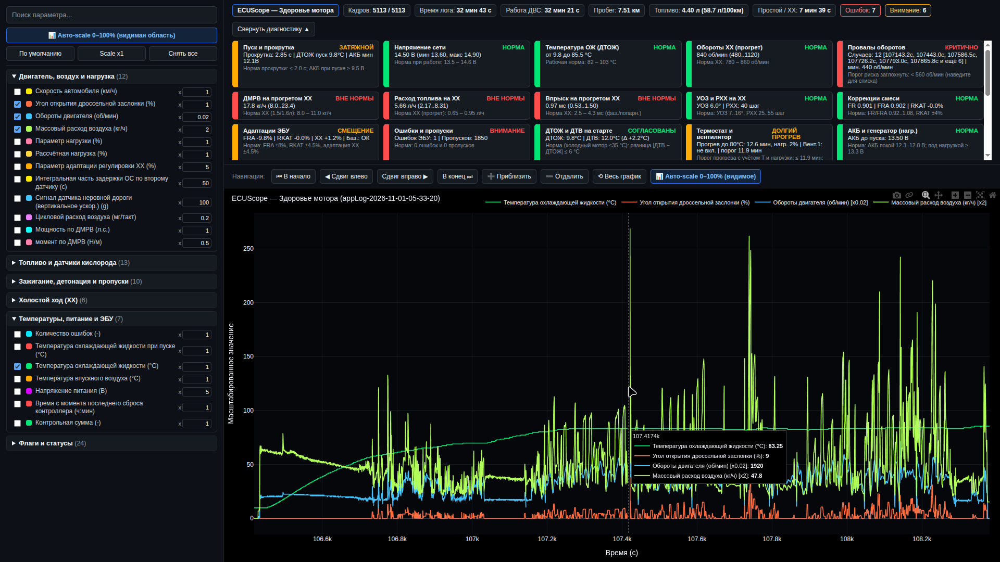

# ECUScope — Здоровье мотора

Интерактивный анализатор диагностических логов **OpenDiag Mobile** и система автоматической оценки состояния узлов двигателя для ЭБУ **Bosch M7.9.7 / M7.9.7+** (протокол KWP2000, пакеты `61 01` и `61 03`).



## Возможности

* **Декодирование сырых логов OpenDiag (`parser.py`):**
  * Разбирает текстовые `.log` / `.txt` файлы (83 дескриптора параметров, битовых флагов и каналов АЦП из пакетов `61 01` и `61 03`).
  * Конвертирует данные в быстрый формат Apache Parquet (`.parquet`) с сохранением совместимости с `.csv`.
* **Панель «Здоровье мотора» (24 автоматические проверки):**
  * **Базовые системы (`diagnose_checks_base.py`):** пуск и прокрутка стартером, напряжение бортсети, ДТОЖ, обороты ХХ, провалы оборотов, ДМРВ на ХХ, часовой расход топлива, длительность впрыска, УОЗ/РХХ на ХХ, коррекции смеси (`FR`/`FRA`/`RKAT`), адаптации ЭБУ (`FRA %`, `RKAT %`, адаптация ХХ, базовая адаптация) и коды ошибок ЭБУ.
  * **Охлаждение и питание (`diagnose_checks_thermal.py`):** адаптивный прогрев, зависание ДТОЖ, просадка термостата на трассе, циклы вентилятора охлаждения, согласованность ДТОЖ и ДТВ на холодном пуске, напряжение АКБ до пуска и просадка генератора под нагрузкой.
  * **Воздушный тракт и ХХ (`diagnose_checks_air.py`):** калибровка нуля и шум дорожек ДПДЗ, АЦП покоя ДПДЗ, отсечка топливоподачи на ПХХ, подсос воздуха и загрязнение дросселя по РХХ, АЦП покоя и динамический отклик ДМРВ.
  * **Топливо и экология (`diagnose_checks_fuel.py`):** старение ДК1 по периоду переключений, вход в замкнутый цикл (Closed Loop) и нагреватель ДК1, продувка адсорбера, дифференциальный тест смеси (ХХ против `1500+ об/мин`), эффективность катализатора по ДК2, загрузка форсунок и дефицит топлива под нагрузкой.
  * **Зажигание и механика (`diagnose_checks_engine.py`):** детонация и отскок УОЗ под нагрузкой, пропуски воспламенения по цилиндрам 1–4, пиковое наполнение ДМРВ, срывы сигнала ДПКВ и динамический диапазон УОЗ.
* **Интерактивный график Plotly (`diagnose.py` + `diagnose_templates.py`):**
  * Масштабирование кривых в реаль времени, поиск по параметрам, переключатель масштаба времени (`с` / `мин`) и режим перетаскивания.

## Установка и запуск

```bash
git clone https://github.com/gordonfedorov/ecuscope.git
cd ecuscope
pip install -r requirements.txt
```

Запуск анализа одного лога (откроет готовый `.html` отчёт в браузере):
```bash
python3 diagnose.py logs/ваш_лог.log
```

Пакетный тестовый прогон всех логов из папки `logs/`:
```bash
chmod +x test_run.sh
./test_run.sh --open
```

## Структура проекта

* `diagnose.py` — главный CLI-скрипт, расчёт пробега/расхода поездки и сборка HTML-отчёта.
* `parser.py` — декодер KWP2000 (`61 01` / `61 03`) и работа с `.parquet` / `.csv`.
* `diagnose_templates.py` — справочник каналов ЭБУ и HTML/CSS/JS-шаблон отчёта.
* `diagnose_utils.py` — общие функции выборки и словарь констант колонок `COL`.
* `diagnose_checks.py` — диспетчер дополнительных проверок.
* `diagnose_checks_base.py` — базовые проверки (12 карточек).
* `diagnose_checks_thermal.py` — охлаждение, пусковые температуры и электропитание.
* `diagnose_checks_air.py` — ДПДЗ, ПХХ, РХХ и отклик ДМРВ.
* `diagnose_checks_fuel.py` — ДК1/ДК2, Closed Loop, адсорбер, катализатор и форсунки.
* `diagnose_checks_engine.py` — детонация, пропуски по цилиндрам, ДПКВ и УОЗ.

## Авторы

* **Идея, постановка задач и тестирование на реальных логах:** `gordonfedorov@gmail.com` ([gordonfedorov](https://github.com/gordonfedorov))
* **Основная разработка кода, алгоритмов диагностики и интерфейса:** ИИ-ассистент Google

## Лицензия

Проект распространяется под лицензией [MIT](LICENSE).
